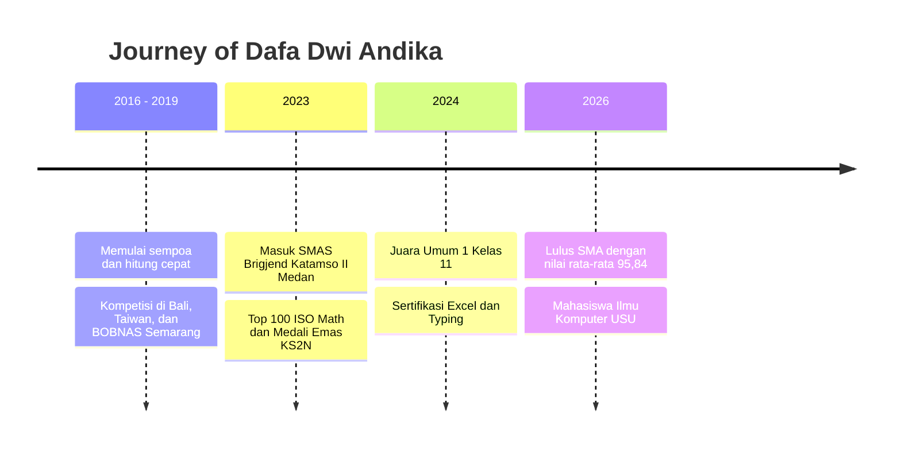
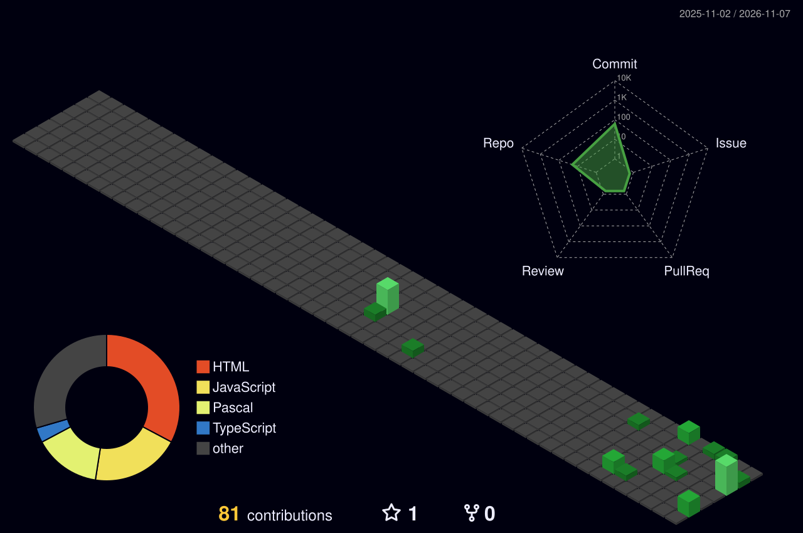

<!-- ═══════════════════════ HEADER ═══════════════════════ -->
<div align="center">


<a href="https://github.com/dfandkaa">
  
</a>

<br/>


<br/>


</div>

<br/>


<!-- ═══════════════════════ ABOUT ═══════════════════════ -->
## 👑 Tentang Saya

```text
┌────────────────────────────────────────────────────────────────────────┐
│  👤  Nama          : Dafa Dwi Andika                                   │
│  ⚔️  Role          : Software Engineer & Creative Writer               │
│  🎓  Pendidikan    : S1 Ilmu Komputer - Universitas Sumatera Utara     │
│  🏫  Alumni        : SMAS Brigjend Katamso II Medan (2023 - 2026)      │
│  📊  Rata-rata     : 95,84 (Nilai Akhir Sekolah)                       │
│  🎮  Proyek Utama  : Cuanverse (Financial RPG App - Next.js)           │
│  ✍️  Hobi          : Worldbuilding, Literary Fiction & Mental Math     │
│  📍  Lokasi        : Medan, Sumatera Utara, Indonesia                  │
└────────────────────────────────────────────────────────────────────────┘
```

Halo! 👋 Saya **Dafa**, mahasiswa **Ilmu Komputer** di **Fakultas Ilmu Komputer dan Teknologi Informasi (Fasilkom-TI), Universitas Sumatera Utara**. Perjalanan saya dimulai dari **sempoa dan hitung cepat** sejak kecil, lalu berlanjut ke **olimpiade matematika**, dan kini bermuara di dunia **pemrograman**.

Bagi saya, **matematika adalah fondasi, kode adalah alatnya, dan cerita adalah jiwanya.** Itulah kenapa saya senang membangun sesuatu yang rapi secara logika, indah secara tampilan, dan bermakna bagi penggunanya.

> 💡 *"Disiplin hari ini adalah prestasi esok hari."*

<br/>

<!-- ═══════════════════════ FOCUS ═══════════════════════ -->
## 🔭 Yang Sedang Saya Kerjakan

| | Fokus | Keterangan |
|:-:|:--|:--|
| 🎮 | **Cuanverse** | Aplikasi *financial RPG*: mengelola keuangan terasa seperti bermain game (Next.js) |
| 📖 | **Web Novel** | Menulis dan membangun dunia (*worldbuilding*) untuk karya fiksi |
| 🧮 | **Matematika Diskrit & Logika** | Pembuktian, logika predikat, dan dasar-dasar berpikir komputasional |
| 🛒 | **Aplikasi POS Grosir** | Sistem kasir dan manajemen toko grosir dengan Next.js, TypeScript, Tailwind, dan Supabase |
| 🌐 | **Web Portofolio** | Etalase karya, prestasi, dan perjalanan saya |

<br/>

<!-- ═══════════════════════ TECH STACK ═══════════════════════ -->
## 🛠️ Tech Stack & Tools

<div align="center">

### 💻 Languages & Frameworks

<br/>


### 🗄️ Backend, Database & Tools

<br/>


</div>

<br/>

<!-- ═══════════════════════ PROJECTS ═══════════════════════ -->
## 🚀 Proyek Unggulan

<div align="center">

<a href="https://github.com/dfandkaa/portofolio">
  
</a>
<a href="https://github.com/dfandkaa/cuanverse">
  
</a>

<a href="https://github.com/dfandkaa/birthdaymama">
  
</a>
<a href="https://github.com/dfandkaa/mkwk-pendidikanberkualitaskel41">
  
</a>

</div>

| Proyek | Deskripsi | Teknologi |
|:--|:--|:--|
| 🌐 **[portofolio](https://github.com/dfandkaa/portofolio)** | Web portofolio pribadi dengan tampilan mewah, animasi, dan daftar prestasi lengkap | `HTML` `CSS` `JavaScript` |
| 🎮 **[Cuanverse](https://github.com/dfandkaa/cuanverse)** | Aplikasi keuangan bergaya RPG yang membuat disiplin finansial terasa seperti petualangan | `Next.js` |
| 🎂 **[birthdaymama](https://github.com/dfandkaa/birthdaymama)** | Halaman web kejutan ulang tahun untuk mama tercinta 💝 | `HTML` |
| 🎓 **[mkwk-pendidikanberkualitaskel41](https://github.com/dfandkaa/mkwk-pendidikanberkualitaskel41)** | Web asesmen minat dan bakat murid SMP, bagian dari proyek MKWK bertema Pendidikan Berkualitas (SDGs 4) | `HTML` |
| 🌐 **[Web Aplikasi Kasir Grosir](https://github.com/dfandkaa/web-kasirgrosir)** | Web kasir untuk grosir toko dengan fitur lengkap | `Next.js` |

<!-- ═══════════════════════ ACHIEVEMENTS ═══════════════════════ -->
## 🏆 Hall of Fame: Prestasi & Penghargaan

<div align="center">


</div>

<details open>
<summary><b>📚 Akademik & Olimpiade</b></summary>
<br/>

- 🥇 **Juara Umum 1** - Kelas 11, SMAS Brigjend Katamso II Medan
- 👑 **Ranking 1** - Kelas 10, 11, dan 12 (tiga tahun berturut-turut)
- 🏅 **Medali Emas KS2N 2023** - Kompetisi Sains Nasional (Matematika)
- 🌟 **Top 100 ISO Math 2023** - International Science Olympiad bidang Matematika
- 🗣️ **Olimpiade Bahasa Inggris** - Peserta dan peraih apresiasi
- 📈 **Rata-rata nilai akhir 95,84**

</details>

<details open>
<summary><b>🧮 Sempoa & Aritmatika Mental</b></summary>
<br/>

- 🇮🇩 **BOBNAS** - Kompetisi Sempoa/Abacus tingkat nasional, Semarang 2019
- 🌴 **Kompetisi Sempoa/Abacus** - Bali 2017
- 🇹🇼 **Sertifikat Sempoa Internasional** - Taiwan 2017

</details>

<details open>
<summary><b>💼 Organisasi & Keterampilan</b></summary>
<br/>

- 🏛️ **Pengurus OSIS** - Kepemimpinan dan kerja sama tim di sekolah
- 📊 **Sertifikasi Microsoft Excel** - 2024
- ⌨️ **Sertifikasi Typing / Keyboarding** - 2024
- 🎨 **Seni** - Pencapaian di bidang kesenian

</details>

<br/>

<!-- ═══════════════════════ TIMELINE ═══════════════════════ -->
## 🧭 Perjalanan Saya



<br/>

<!-- ═══════════════════════ STATS ═══════════════════════ -->
## 📊 GitHub Stats

<div align="center">


<br/>


<br/>


<br/>


</div>

<br/>

<!-- ═══════════════════════ 3D CONTRIBUTION ═══════════════════════ -->
## 🌿 Contribution Graph 3D

<div align="center">



</div>

<!-- ═══════════════════════ SNAKE ═══════════════════════ -->
## 🐍 Snake Eating My Contributions

<div align="center">

<picture>
  <source media="(prefers-color-scheme: dark)" srcset="https://raw.githubusercontent.com/dfandkaa/dfandkaa/output/github-snake-dark.svg" />
  
</picture>

</div>

<br/>

<!-- ═══════════════════════ NOVEL ═══════════════════════ -->
## ✍️ Sisi Lain: Penulis & Worldbuilder

Di luar layar kode, saya menulis **web novel** dan merancang dunia fiksi dengan sistem, sejarah, dan karakter yang saling terhubung. Cara berpikir seorang *developer* sangat membantu di sini: **dunia cerita yang baik dibangun seperti arsitektur sistem**, dengan aturan yang konsisten, detail yang saling mengunci, dan alur yang masuk akal.

```text
📖 Genre favorit    : Fantasy, Literary Fiction, RPG-inspired Story
🌍 Spesialisasi     : Worldbuilding & Character Development
🎮 Inspirasi        : Game RPG, filsafat, dan matematika
```

<br/>

<!-- ═══════════════════════ GOALS ═══════════════════════ -->
## 🎯 Tujuan & Visi

- [x] 🎓 Lulus SMA dengan prestasi terbaik
- [x] 🏫 Diterima di Ilmu Komputer, Universitas Sumatera Utara
- [x] 💻 Membuat web portofolio pribadi
- [ ] 🎮 Meluncurkan **Cuanverse** ke pengguna nyata
- [ ] 📱 Menguasai pengembangan aplikasi mobile
- [ ] 🧠 Mendalami algoritma, struktur data, dan matematika diskrit
- [ ] 📚 Menerbitkan karya web novel pertama
- [ ] 🌍 Berkontribusi pada proyek open source
- [ ] 🏆 Meraih prestasi di kompetisi pemrograman tingkat nasional

<br/>

<!-- ═══════════════════════ QUOTE ═══════════════════════ -->
<div align="center">


</div>

<br/>

<!-- ═══════════════════════ CONTACT ═══════════════════════ -->
## 📬 Mari Terhubung

<div align="center">

[](https://github.com/dafadwiandika2-beep)
[](https://github.com/dfandkaa/portofolio)
[](mailto:dafadwiandika2@gmail.com)
[](https://instagram.com/dfandk_)
[](https://www.linkedin.com/in/dafa-dwi-andika-935834379/)

<br/>

### 🤝 Terbuka untuk kolaborasi proyek, diskusi teknologi, dan sharing seputar coding, matematika, dan dunia fiksi!

<br/>


</div>

<!-- ═══════════════════════ FOOTER ═══════════════════════ -->

